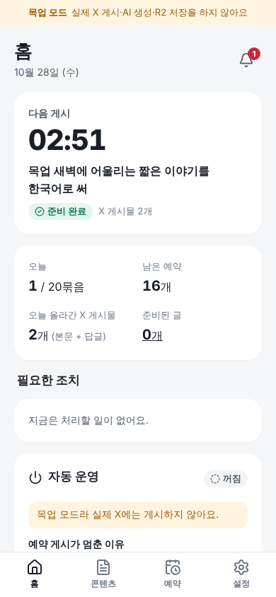
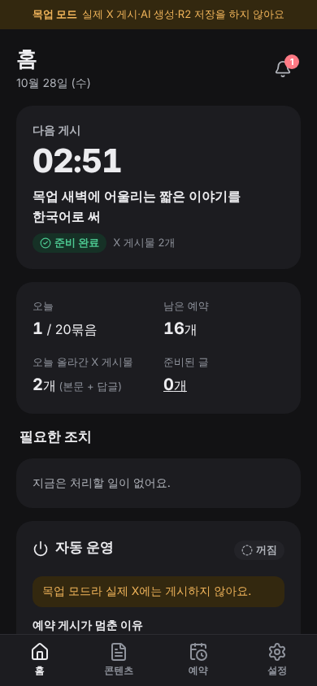
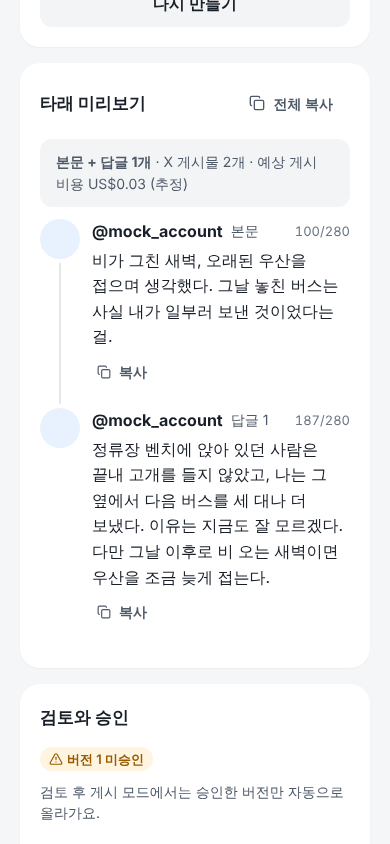
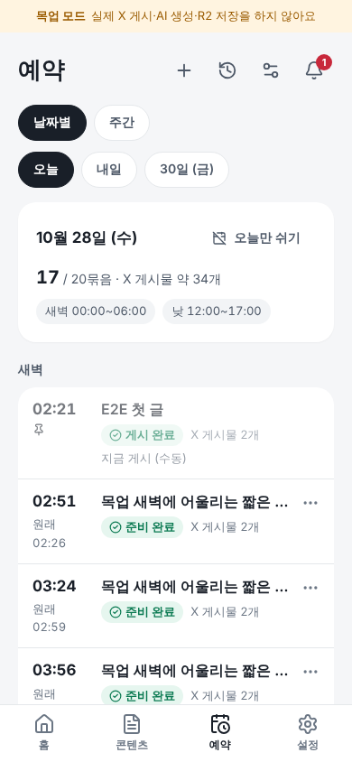
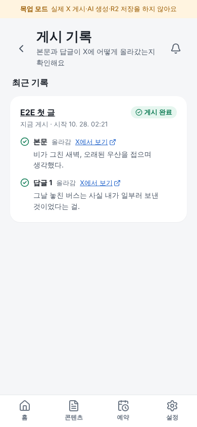

# x-automation

운영자 한 명이 X 타래(본문 + 자기 답글)를 **만들고 → 나누고 → 이미지를 붙이고 → 예약하고 → 게시하고 → 결과를 확인**하는, 휴대폰에서 앱처럼 쓰는 웹이다.
Go 서버 하나가 화면(React)과 API를 함께 제공하고, 데이터는 PostgreSQL, 이미지는 Cloudflare R2에 둔다.

| 홈 | 다크 모드 | 타래 미리보기 | 예약 | 게시 기록 |
|---|---|---|---|---|
|  |  |  |  |  |

화면은 목업 모드(테스트용 데이터, 실제 X 게시 없음)에서 찍었다.

## 무엇을 하나

- **글 준비**: 직접 쓰기·여러 개 붙여넣기·CSV/JSON 가져오기, 또는 등록한 프롬프트로 AI 생성(설정한 시각에 미리 / 예약 N분 전 / 재고 유지 / 게시할 때 / 버튼). 이미 있는 글을 먼저 쓰고 부족한 만큼만 만든다
- **나누기**: X와 같은 방식(공식 twitter-text)으로 글자 수를 세서 본문 + 답글로 나눈다(한글 2자, 링크 23자). 원문은 그대로 보관한다
- **예약**: 새벽·낮 같은 여러 허용 구간, 하루 묶음 수, 기본 간격 30분 + 예약마다 정해 둔 추가 지연. 재시작해도 시각이 바뀌지 않는다
- **게시**: 본문을 올린 뒤 그 아래에 자기 답글을 순서대로. 실패한 답글부터 다시, 결과를 모르는 요청은 자동으로 다시 보내지 않는다
- **운영**: 홈의 다음 게시·오늘 수량·필요한 조치, 앱 안 알림, 추정 비용과 월 한도, 게시 후 14일 이미지 정리

## 빠른 시작 (로컬, 목업)

필요: Go(1.27, `go.mod`의 toolchain을 자동으로 받음), Node.js 22.13+, PostgreSQL 16(Docker가 있으면 `make dev`가 띄운다).

```bash
make setup                         # 의존성 설치, .env 생성 (비밀값은 만들지 않음)
go run ./cmd/admin hash-password   # 관리자 비밀번호 → .env의 ADMIN_PASSWORD_HASH
go run ./cmd/admin gen-key         # → .env의 TOKEN_ENCRYPTION_KEY
make dev                           # 로컬 DB + API(:8080) + 화면(:5173)
```

http://localhost:5173 에서 `.env`의 `ADMIN_USERNAME`과 위 비밀번호로 로그인한다. `.env.example`의 기본값은 `INTEGRATION_MODE=mock`이라 X·AI·R2 대신 테스트 대역을 쓴다(화면 위에 "목업 모드" 띠).

| 명령 | 내용 |
|---|---|
| `make test` | Go(DB 통합 포함, `TEST_DATABASE_URL`)·Vitest |
| `make lint` | go vet·staticcheck·tsc·ESLint |
| `make build` | 프론트 빌드 후 화면을 포함한 `bin/server` |
| `make e2e` | 전용 테스트 DB + 목업으로 브라우저 E2E (Chromium 필요) |
| `make docker-build` | 배포 이미지 (`PLATFORM=linux/arm64` 등) |

## 처음 설정

로그인하면 홈의 **첫 설정**이 순서대로 안내한다.

1. **연결 상태**: X 계정 연결(목업은 바로 연결), AI·R2 설정 여부
2. **프롬프트**: 쓰던 프롬프트를 붙여넣어 등록하고 자동 생성의 기본 프롬프트로 지정. `{{주제}}` 같은 변수는 프롬프트 화면에서 기본값을 정한다
3. **운영 모드**
   - **게시만 자동**: 직접 쓴 글·이미지만 앱이 나누고 예약해 올린다. 생성 비용 없음
   - **검토 후 게시**(기본): 만든 글은 검토 대기로 두고 **승인한 버전만** 올린다. 승인 뒤 고친 내용은 다시 승인해야 한다
   - **완전 자동**: 설정대로 준비하고 검증을 통과한 글을 예약 게시
4. **시간표**: 허용 구간(기본 새벽 00:00–06:00, 낮 12:00–17:00), 하루 묶음 수(기본 20), 간격. 바꾸기 전에 미리보기로 시각을 확인한다
5. **확인**: 설정을 마쳐도 **자동 운영은 꺼진 채**다. 홈에서 직접 시작한다

## 꼭 알아 둘 것

- **생성 시점과 게시 시점은 다르다.** 생성은 위 생성 방식대로, 게시는 예약 시각에 한다. 시간표를 바꿔도 이미 만든 글·이미지를 다시 만들지 않는다
- **묶음 수와 X 게시물 수는 다르다.** "하루 20묶음"은 본문 + 답글 묶음 20개다. 묶음 하나는 기본 X 게시물 2개(본문 + 답글 1개)이고, 길면 답글이 늘어난다. 예약·홈·편집기에 실제 게시물 수를 따로 보여 준다
- **이미지는 공개 주소로 저장된다.** 아직 게시하지 않은 이미지도 주소를 아는 사람은 볼 수 있다. 게시가 끝난 묶음의 이미지는 **마지막 게시 완료 후 14일**(설정 가능)이 지나면 저장소에서 지운다 — 업로드 날짜 기준이 아니고, 한 번도 게시하지 않았거나 아직 쓰는 이미지는 지우지 않는다. 게시 기록·원문·X 링크는 남는다
- **비용은 추정치다.** 앱이 센 사용 횟수에 설정의 요율표(확인일·출처를 직접 적음)를 곱한다. 실제 청구액은 X 개발자 콘솔·AI 공급자·Cloudflare에서 확인한다. 링크가 든 X 게시는 단가가 훨씬 높다. 월 한도를 정하면 실행 전에 비용을 먼저 확보해 한도를 넘지 않는다

## 멈추기·복구

- **일시정지**: 홈에서 생성만, 게시만, 또는 자동 운영 전체를 멈출 수 있다(재배포 후에도 유지)
- **답글이 실패했어요**: 게시 기록 → **실패한 답글부터 다시**. 본문은 다시 올리지 않는다
- **결과 확인이 필요해요**: 보냈지만 응답을 못 받은 경우다. X에서 확인해 **올라가 있어요(주소 입력)** 또는 **안 올라갔어요**를 고르면 남은 부분부터 이어 간다. 확인 없이 다시 보내려면 중복 위험을 확인해야 한다
- 자세한 운영·장애 대응·백업: [docs/OPERATIONS.md](docs/OPERATIONS.md)

## 배포와 실제 게시

- 배포 대상은 KoDeploy(ARM64, BuildKit). 저장소 루트의 `Dockerfile`을 그대로 쓴다. **main에 푸시해도 자동 배포되지 않고**, KoDeploy 화면에서 재배포한다. 순서: [docs/DEPLOY_KODEPLOY.md](docs/DEPLOY_KODEPLOY.md)
- 실제 게시는 세 가지가 모두 있어야 시작된다: 서버 환경변수 **`PUBLISHING_ENABLED=true`** + **X 계정 연결** + 앱 홈의 **자동 운영 시작**. 기본은 꺼짐
- 급히 멈추기: 홈의 게시 일시정지(즉시) 또는 `PUBLISHING_ENABLED=false`(재시작). 되돌리기는 예전 커밋을 다시 배포

## 검증 상태

| 구분 | 내용 |
|---|---|
| 구현·자동 검증 완료 | 14단계 전부. Go 테스트(인증·설정·마이그레이션·분할 적합성·생성 정책·시간표·게시 복구·경쟁·예산·알림·이미지 정리·작업 큐), Vitest, 브라우저 E2E 12개(목업), 컨테이너 빌드·실행(amd64), arm64 교차 빌드 |
| 가짜 서버로 검증 | X 게시·OAuth·토큰 갱신(실제 HTTP 클라이언트 + 가짜 X 서버), OpenAI 응답 해석, R2(가짜 S3) |
| **실연동 미검증** | 실제 X 계정 연결·게시·자기 답글 제한 여부, 실제 AI 모델 생성, 실제 R2 버킷, 실제 KoDeploy 배포. 자격증명이 없어 확인하지 않았다 — 목업 성공을 실제 성공으로 보지 않는다 |

## 문서

| 문서 | 내용 |
|---|---|
| [docs/ARCHITECTURE.md](docs/ARCHITECTURE.md) | 구조와 주요 결정 (시간표·게시·복구·정리) |
| [docs/API.md](docs/API.md) | API 목록과 공통 규칙 |
| [docs/DEPLOY_KODEPLOY.md](docs/DEPLOY_KODEPLOY.md) | KoDeploy 배포 순서·환경변수 |
| [docs/OPERATIONS.md](docs/OPERATIONS.md) | 운영·문제 해결·비용·백업 |
| [docs/TESTING.md](docs/TESTING.md) | 테스트 구성과 실연동 미검증 항목 |
| [docs/INTEGRATIONS.md](docs/INTEGRATIONS.md) | X·OpenAI·R2·KoDeploy 확인 기록(확인일·근거) |
| [docs/DESIGN.md](docs/DESIGN.md) | 화면 디자인 기준 |
| [docs/PROGRESS.md](docs/PROGRESS.md) | 단계별 기록과 인수 조건 추적 |
| [docs/BUILD_INSTRUCTIONS.md](docs/BUILD_INSTRUCTIONS.md) | 요구사항 원문 |
